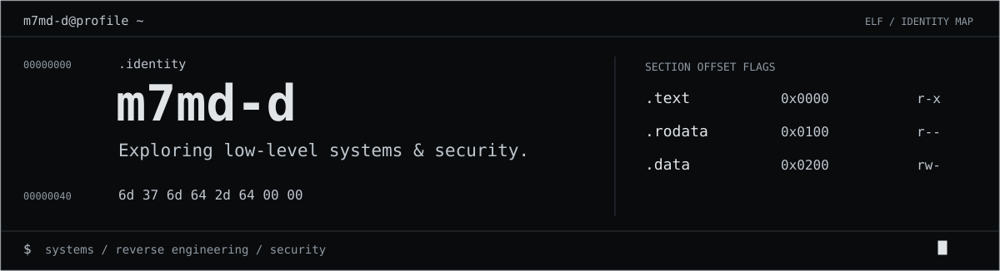
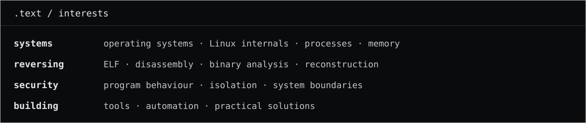
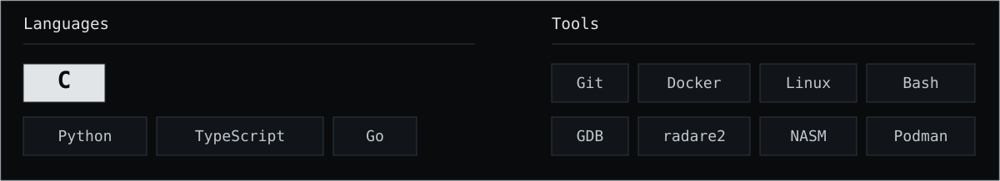
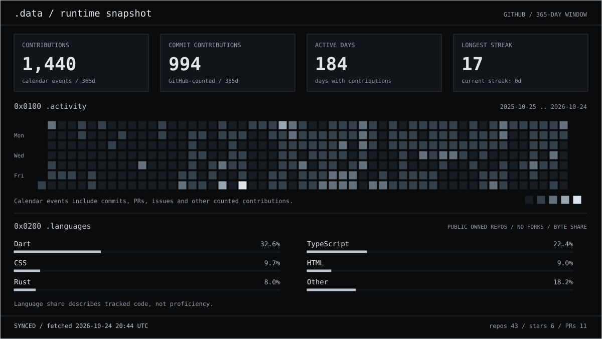

  <picture>
    <source media="(max-width: 600px)" srcset="./assets/header-machine-mobile.svg" />
    
  </picture>

  <picture>
    <source media="(max-width: 600px)" srcset="./assets/interests-mobile.svg" />
    
  </picture>

  <picture>
    <source media="(max-width: 600px)" srcset="./assets/toolchain-mobile.svg" />
    
  </picture>

  <picture>
    <source media="(max-width: 600px)" srcset="./assets/runtime-mobile.svg" />
    
  </picture>

  <picture>
    <source media="(max-width: 600px)" srcset="./assets/traces-heading-mobile.svg" />
    
  </picture>

[krpt — ELF → source](https://github.com/Jnbla6/krpt/commit/453ae75dbb6d5b7fa14494c9f224f6ad13027f98) — Reverse engineered an ELF decryption stub and reconstructed its source in Rust.

  <picture>
    <source media="(max-width: 600px)" srcset="./assets/projects-heading-mobile.svg" />
    
  </picture>

- [E3KS](https://github.com/m7md-d/E3KS) — Replace colours and fonts across Word and PowerPoint files.
- [Hayn](https://github.com/m7md-d/Hayn) — A free, on-device media toolkit. In development.
- [COMMANDER](https://github.com/m7md-d/COMMANDER) — GitHub push audits, delivered as satirical military reports to Discord.
- [DRC](https://github.com/m7md-d/DRC) — Raw disk imaging, USB port monitoring, and file extraction.
